<div align="center">

# Hi there, I'm Akanksha 👋

### Building things with AI, one prompt at a time ✨


[](https://www.linkedin.com/in/akanksha-soni-351002289)
[](https://github.com/Akanksha2675)
[](https://akanksha-soni-portfolio.vercel.app)
[](mailto:akankshasoni212005@gmail.com)

</div>

---

### 🧭 About Me

```yaml
name: Akanksha Soni
education: B.Tech CSE, OP Jindal University (GPA 8.20/10, Expected 2027)
focus: [Generative AI, RAG, Multi-Agent Systems, Full-Stack Dev]
currently: "Completing P.I.V.O.T 2.0 — GenAI & LLM Engineering @ Verbly AI"
looking_for: Software Engineering Internship 👀
fun_fact: "Was a Google Student Ambassador — got people excited about Gemini before it was cool"
```

---

### 🛠️ Tech Stack

<div align="center">

**Languages**
<br>


**Frontend**
<br>


**Backend & Data**
<br>


**AI / LLM**
<br>


**Design & Tools**
<br>


</div>

---

### 🚀 Featured Projects

<div align="center">

<a href="https://github.com/Akanksha2675/TripIt"></a>

<a href="https://github.com/Akanksha2675/chatgpt-clone"></a>

<a href="https://github.com/Akanksha2675/Prompt-Tester-App"></a>

<a href="https://github.com/Akanksha2675/Outreach-Pipeline"></a>

<a href="https://github.com/Akanksha2675/College-Discovery-Platform"></a>

</div>

---

### 🤝 Team & Open-Source Contributions

<div align="center">


</div>

<div align="center">

<a href="https://github.com/EngageU-Education-App/EngageU-website"></a>

<a href="https://github.com/Rohitkumar43/yourautomation"></a>

<a href="https://github.com/Veer376/chatgpt-clone"></a>

</div>

---

### 📈 GitHub Stats

<div align="center">

<table>
<tr>
<td align="center" valign="middle" width="50%">

</td>
<td align="center" valign="middle" width="50%">

</td>
</tr>
<tr>
<td colspan="2" align="center">

</td>
</tr>
</table>

</div>

---

### 🎖️ Training & Certifications

- 🧠 **P.I.V.O.T 2.0** — GenAI & LLM Engineering Program, Verbly AI *(June 2026 – Present)*
- 🌐 **Google Student Ambassador**, PING Network — Campus Ambassador *(2025)*
- 📜 C++ Data Structures & Algorithms — Apna College *(2026)*
- 📜 Introduction to Internet of Things — NPTEL *(2025)*
- 📜 Programming for Everybody — Coursera *(2025)*
- 📜 Data Analytics Essentials — Cisco Networking Academy *(2025)*

---

<div align="center">

### 💭 Currently

🌱 Deep in RAG & multi-agent systems &nbsp;|&nbsp; 💼 Open to SWE internships &nbsp;|&nbsp; 💼 Open to AI internships

📫 Reach me at **akankshasoni212005@gmail.com**


</div>
